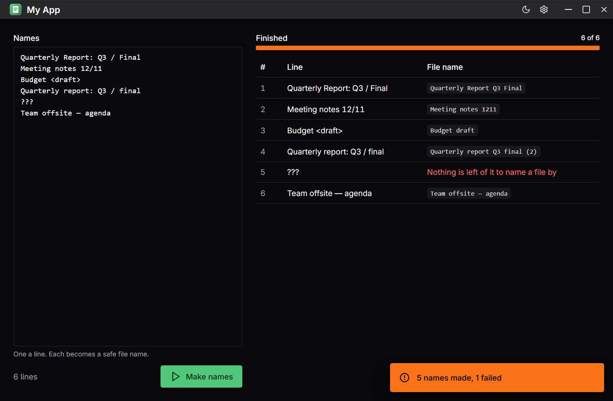
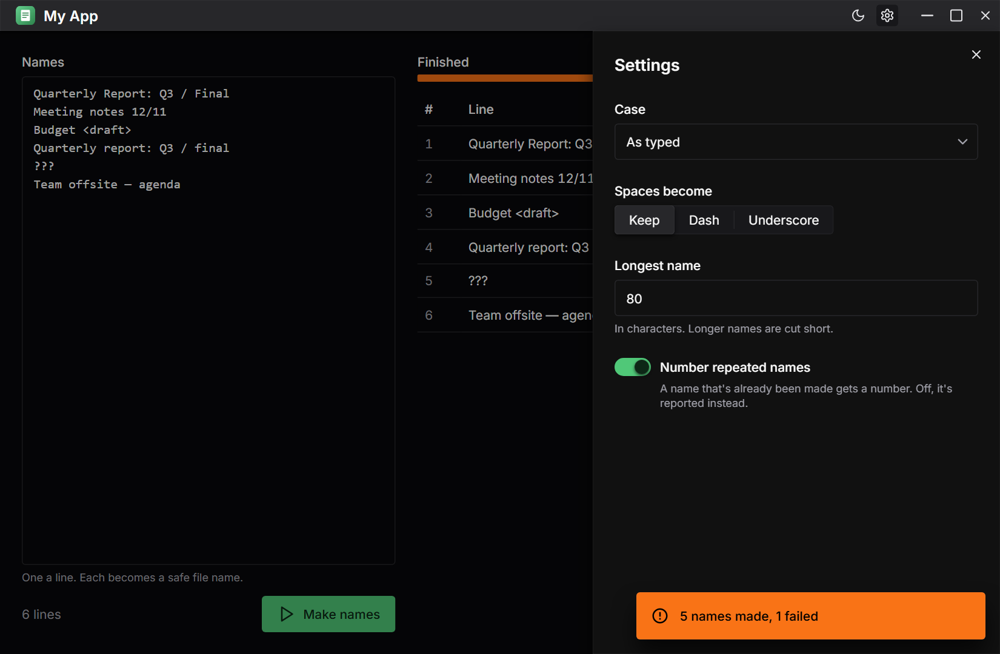

<!-- template:start -->

# Tauri app template

A desktop app on Tauri 2, React 19 and Chakra UI v3, with everything around it already set up:
a pnpm workspace with one version of each shared dependency, oxlint and oxfmt, Storybook for
every package with each story run as a test in headless Chromium, CI, signed releases that the
app updates itself from, a prerendered marketing site with a download page, generated
screenshots, and instructions and skills for coding agents.

The app it comes with is a small example that shows each part working: type names, one a line,
and it makes each a safe file name, reporting its progress job by job, with settings in a drawer.
Replace it with your own and keep the plumbing.

## Start a project from it

1. On GitHub, **Use this template** › **Create a new repository** (or
   `gh repo create my-thing --template <owner>/tauri-app-template --private --clone`).
2. In the new repository:

   ```sh
   corepack enable          # once, for pnpm
   pnpm install
   pnpm template:init       # asks for the name, the owner, the core and whether to keep the site
   ```

   It renames everything, keeps the core you chose and deletes the other, and prints what's
   left to do: the icon, the updater's signing key and the repository's secrets. A coding agent
   reading `AGENTS.md` will offer to run it for you.

## Rust core or TypeScript core

The front end reaches the core through two files, `apps/desktop/src/api.ts` and
`apps/desktop/src/core-types.ts`, so it works the same over either.

- **Rust** (`crates/core` and a `my-app` command line tool): the core runs in the app's Tauri
  process, and its types reach the front end through ts-rs. It comes with a shared HTTP client
  with rate limits, retries and 429 handling, tested against wiremock. Choose it for network or
  file work, anything heavy, or a command line tool.
- **TypeScript** (`packages/core`): the core runs in the window with the interface, and Rust is
  only the shell. Choose it for an app whose logic is mostly computation and state.

## What else is in here

- **A title bar of the app's own** on Windows and Linux, macOS's traffic lights kept over it,
  and dialogs and drawers that open below it and leave it usable.
- **`packages/ui`**: Chakra's snippets, a theme with an emerald accent, recipes, and the
  Storybook preview every package shares. oxlint stops a component from skipping a snippet.
- **Agents**: `AGENTS.md`, synced to `CLAUDE.md`, the Chakra and Storybook MCP servers for
  Claude Code, Cursor and VS Code, and skills for Chakra, code review, screenshots and releases.
- **Releases**: push a `v*` tag and `release.yml` builds Windows, macOS and Linux installers into
  a draft release with a signed update manifest; publishing it updates every installed copy.
- **The site**: Vite, TanStack Router and static prerendering, deployed to Cloudflare Pages, with
  a download page that sorts the latest release's files by system, and previews for pull
  requests.

The rest of this README is the example app's, as a new project starts with it.

---

<!-- template:end -->

# My App



My App turns a list of names into safe file names, on Windows, macOS and Linux.

## Download

Get the installer for your system from the [latest release](https://github.com/your-github-user/my-app/releases/latest)<!-- site:start -->,
or from [the site](https://example.com/download)<!-- site:end -->. Once installed, the app offers
each new version itself.

## Using it

Type or paste names, one a line, and press **Make names**. Each line becomes a file name that
Windows, macOS and Linux all accept, shown beside it as it's made. **Settings**, in the header,
choose the case, what spaces become, the longest name, and whether a repeated name gets a number.



<!-- core:rust:start -->

## From the command line

`my-app` does what the app does, and reads the same settings:

```sh
my-app names.txt                    # a file, one name a line
echo "Quarterly Report" | my-app -  # standard input
```

<!-- core:rust:end -->

## Building it

You need [Node](https://nodejs.org) 24, pnpm (`corepack enable`), [Rust](https://rustup.rs), and
[Tauri's system dependencies](https://v2.tauri.app/start/prerequisites/).

```sh
pnpm install
pnpm tauri-dev                     # the app, with hot reload
pnpm storybook                     # every package's Storybook
pnpm test                          # unit tests, and every story in headless Chromium
cargo test --workspace
pnpm --filter desktop tauri build  # installers for this system
```

[AGENTS.md](AGENTS.md) describes how the code is laid out and the rules it follows.

## Licence

[GPL-3.0-or-later](LICENSE).
